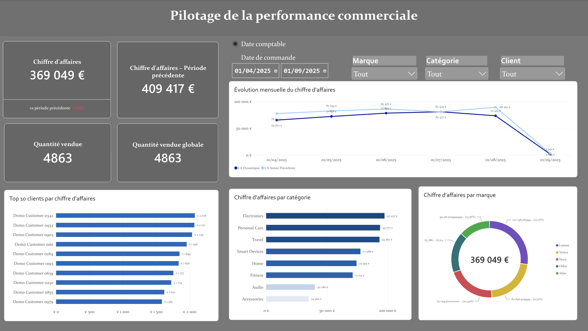
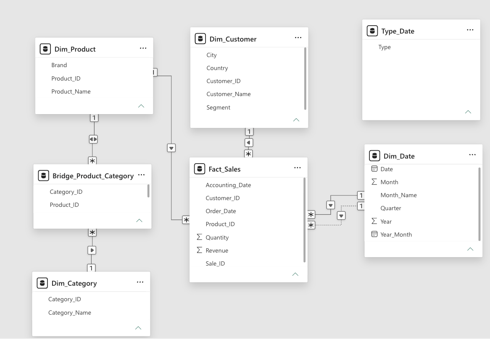
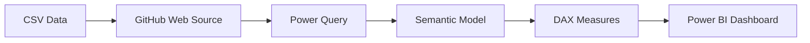

# Retail Sales Analytics Dashboard with Power BI

An interactive Business Intelligence project for retail sales performance analysis, using Power BI, DAX, Power Query and synthetic data.

## Overview

This project focuses on commercial performance monitoring through dimensional data modeling, dynamic KPI calculation and interactive data visualization.

The dashboard enables users to analyze sales performance across different periods, product categories, brands and customers.

## Dashboard Preview

## Technologies

- Microsoft Power BI
- Power Query (M)
- DAX
- Dimensional Data Modeling
- CSV & Web Data Sources
- GitHub

## Data Model

The semantic model includes:

- **Fact_Sales:** Sales transactions
- **Dim_Product:** Product and brand information
- **Dim_Customer:** Customer information
- **Dim_Date:** Calendar dimension
- **Dim_Category:** Product categories
- **Bridge_Product_Category:** Product-category relationships
- **Type_Date:** Dynamic date selection

The model uses fact and dimension tables, a bridge table for multiple product-category assignments, and relationships supporting accounting-date and order-date analysis.

## Architecture

## Key Features

- Data ingestion through GitHub Raw URLs
- Data transformation using Power Query
- Dimensional data modeling
- Dynamic revenue calculation
- Year-over-year revenue comparison
- Sales growth analysis
- Monthly revenue trends
- Top 10 customers by revenue
- Revenue analysis by product category and brand
- Interactive date, brand, category and customer filters

## Business KPIs

| KPI | Dashboard Value |
| --- | ---: |
| Total Revenue | EUR 369,049 |
| Previous Period Revenue | EUR 409,417 |
| Revenue Growth | -9.86% |
| Units Sold | 4,863 |

These results correspond to the selected accounting-date period from April 1 to September 1, 2025.

## Dataset

The project uses synthetic retail data for demonstration purposes.

The dataset includes:

- 8,000 sales records
- 80 products
- 1,000 customers
- 8 product categories
- A calendar dimension
- A product-category bridge table

CSV files are stored in the repository root to maintain stable Web data source URLs.

## Project Files

- [Power BI File](dashboard/Retail_Sales_Analytics.pbix)
- [Dashboard PDF](dashboard/Retail_Sales_Analytics.pdf)
- [DAX Documentation](docs/measures.md)

## How to Use

1. Download the PBIX file.
2. Open it using Power BI Desktop, or import it into Power BI Service where supported.
3. Configure anonymous authentication for the GitHub Web data sources if required.
4. Refresh the semantic model.
5. Explore the dashboard using interactive filters.

## Scope and Limitations

This project is a portfolio demonstration using synthetic data, rather than a production BI deployment.

Products may belong to multiple categories. Therefore, category-level revenue is not necessarily additive across all categories.

## Author

Hongmin Xie

[LinkedIn](https://www.linkedin.com/in/hongmin-xie/)
